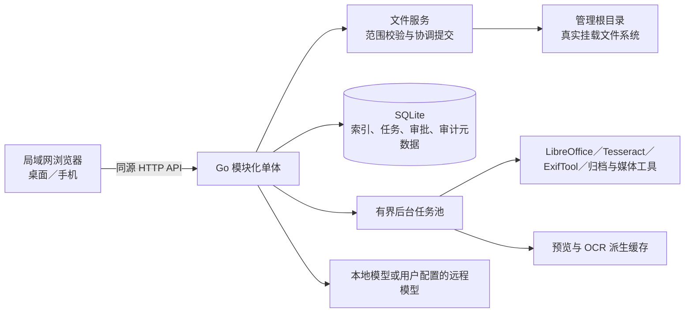

# FileSage 技术决策基线与 ADR

初始决策日期：2026-10-15。状态更新：2026-10-20。**核心实现已部署到个人 Linux 服务并持续验收；真实样本、故障恢复与容量基线仍未全部完成。**用户授权助手决定 ADR-0001～0006、0008 的技术取舍；ADR-0007 为用户指定 React 后按授权定稿。以下状态区分自动化／隔离服务证据与目标主机验收，不代表整体成熟。对应[成熟需求基线](PRD.md)。

## 已选择的技术基线

采用单机模块化单体：Go 1.27.2 或更新的安全补丁版后端 + React／TypeScript／Vite 前端；SQLite 配 WAL，由纯 Go `modernc.org/sqlite` 驱动保存可重建索引及任务／审批状态；原生挂载文件系统仍是文件内容唯一事实来源。图片、文本、PDF、DOCX、EPUB、表格使用格式专用阅读组件；PPTX 由受限 LibreOffice 生成只读派生预览；OCR、解码和归档工具按任务启动为本机子进程。

对 Agent 写入，先生成经人工审计的计划，再由统一文件服务逐步协调、检查状态并提交；普通文件内容采用同目录临时文件加替换，跨盘移动采用复制、校验、发布、再删除源文件的持久任务。写协调同时使用路径和 `(device, inode)`，覆盖进程内硬链接别名竞争；不阻止其他进程直接修改文件，关键操作在提交前复核身份与内容状态。通过内部软链接读取和列目录，写入须针对明确的目标路径。Shell 是一种有界工具：仅在 Bubblewrap 隔离暂存副本中运行，命令、范围和可核实的文件变化进入计划；审计通过后作为一个步骤由统一提交器写回。全局 `bypasspermission` 默认开启，计划审计仍是必需门禁；关闭后每步单独确认。原件旧内容不进入历史或备份。tusd 只接收可续传上传到私有暂存区；最终目录发布由 FileSage 协调器完成。

无密码访问是已确认需求；可达服务的设备拥有完整能力。服务默认仅监听回环地址，部署到局域网时需显式绑定指定私有网卡地址并配置网络防火墙。服务以专用非 root 用户运行，实际读写范围由挂载点与 Unix 权限共同限定。硬链接内容写入、SQLite 驱动、上传协议、沙箱不可用时的策略及首轮性能门槛均已由受托技术负责人选定，具体证据和实施验证见下文与各 ADR。

## 部署形态与边界

| 边界 | 建议约束 | 失败表现 |
| --- | --- | --- |
| 用户文件 | 仅通过统一文件服务读写；管理根目录和其内已挂载卷是操作范围；根目录之外不作为存储目标 | 越界、悬空链接、循环、卸载卷或权限错误均明确失败，不回退到空目录 |
| 服务状态 | SQLite、配置、日志、临时任务状态放在独立服务数据目录，不放入用户整理范围；预览/OCR 是可删可重建的派生缓存 | 状态库损坏时停止写操作并提供诊断；重建索引不能覆盖原生文件 |
| 本机工具 | 以无特权服务用户运行；按任务调用独立进程，清理环境变量、限定输入输出路径、资源和时限 | 工具缺失或不支持时只禁用相应预览／任务，不影响基础文件管理 |
| 模型服务 | 仅通过显式配置的本地或远程端点；调用前说明会发送的内容范围；密钥仅在服务端保存 | 超时、限流或不可用时保留分析／任务错误，不阻塞浏览、上传和手动操作 |
| 网络 | 按用户需求提供局域网访问，无账号密码；开发／默认配置仅监听 `127.0.0.1`，部署时显式设置 `FILESAGE_LISTEN_ADDR` 为服务器私有网卡地址，并通过 Host 白名单接受实际访问域名 | 客户端断线不改变已提交结果；所有长任务可查询状态 |

无认证意味着任何能够访问服务的设备都可以执行删除、权限调整、Shell 等高影响操作。服务入口按规范化 Host 主机名／IP 白名单拒绝未知 Host，以降低 DNS rebinding 风险；写请求继续检查 Origin。白名单默认包含监听 IP 与 `localhost`、`127.0.0.1`、`::1`，`FILESAGE_ALLOWED_HOSTS` 可追加逗号分隔的主机名或 IP，端口不参与匹配。Origin／Fetch Metadata 检查不能限制同一局域网内的其他设备；局域网部署仍须绑定指定私有网卡并配置防火墙。服务目前只提供 HTTP 直连，不读取 `X-Forwarded-Proto`；HTTPS 终止型代理向后端转发 HTTP 时，同源写请求会被拒绝，因此该部署方式暂不支持。产品遵循 PRD，不额外加入密码。

## 核心选型对比

### 服务端

| 方案 | 适配点 | 主要代价 | 结论 |
| --- | --- | --- | --- |
| Go 模块化单体 | 有标准库 HTTP、并发、单一服务部署；Go 1.24 起有根目录约束 API；已有 tusd、文件浏览竞品与 Go SQLite 驱动可参考 | 文档解析仍需专用库或本机工具；`os.Root` 有版本相关安全修复，不能固定在含漏洞版本 | **建议**，依赖 Go 1.27.2 或更新且保持安全补丁；上线构建前查官方支持与漏洞公告 |
| Python + FastAPI | 文档、图像、OCR、Office 处理生态广；Paperless、Docling、Unstructured 等有可读实现参考 | 原生文件边界与 TOCTOU 安全需更细致实现／额外库；运行时、依赖和打包面更大 | 适合以解析和 AI 数据处理为主的团队；本产品的高权限文件写路径更难收口 |
| Go API + Python 工作服务 | 文件服务保持 Go；可直接复用 Python 解析库 | 两套运行时、进程协议、部署和资源治理；单用户 MVP 的故障面扩大 | 仅当原型证明 Go 进程工具调用无法覆盖 DOCX/OCR 需求时再拆 |
| Rust + Axum | 编译期内存安全，异步 HTTP 生态可用 | 本地文件／文档集成仍需跨语言工具；实现和调试门槛未知，未观察到本项目团队经验 | 可行备选；没有证据显示它比 Go 在本需求上有足够收益 |

建议先保持**单个 Go 服务进程**，把文件、上传、索引、Agent 审批和任务生命周期作为内部模块，不拆微服务。LibreOffice、Tesseract、ExifTool、归档／媒体工具是按任务启动、受限且可失败的子进程，不构成常驻服务集群。Go 官方 `os.Root` 能约束路径与越界软链接，但 2026 年曾公布涉及末尾斜杠软链接的越界漏洞；使用前须确认选用版本已包含修复，并为软链接路径写回归验证。[Go `os.Root` 设计说明](https://go.dev/blog/osroot)、[官方漏洞公告 GO-2026-4970](https://pkg.go.dev/vuln/GO-2026-4970)、[Go 发布与支持记录](https://go.dev/doc/devel/release)。

### 前端

前端定为 React + TypeScript + Vite，并由 Go 服务同源提供静态资源。基础对话框、菜单和选择控件使用 Radix Primitives；业务组件和样式由 FileSage 自行维护，不引入完整后台模板。图标统一使用 `lucide-react`。界面布局、手机端四入口和关键流程见已定稿的 [UI/UX 基线](design/UIUX.md)；[交互原型](design/prototype/README.md)用于审阅布局与示例状态，不代表生产功能或真实手机验证已经完成。

### 元数据、索引与后台任务

| 方案 | 优点 | 代价 | 结论 |
| --- | --- | --- | --- |
| SQLite（本机服务数据盘） | 无独立数据库服务；单实例部署简单；WAL 支持读写并行、事务保持一致快照；FTS5 可提供路径子串索引 | 同一时刻仍只有一个写事务；WAL 不适用于网络文件系统；数据库不可与 WAL/SHM 文件拆开复制 | **建议**存索引、任务、审批、审计元数据；数据库放本机文件系统而非用户数据挂载卷 |
| PostgreSQL | 多进程和并发写能力强，成熟查询能力 | 另装、配置、升级和备份服务；对单用户单机暂时没有已测出的必要负载 | 若后续多进程部署或 SQLite 写入实测成为瓶颈，再迁移 |
| 不建持久索引／每次遍历 | 状态始终即时读取真实文件系统；组件最少 | 大目录搜索、媒体筛选和外部改动协调成本高；无法高效恢复长任务状态 | 不适合 PRD 的搜索、并发和任务恢复 |

文件系统仍是权威数据。SQLite 的目录记录可全量扫描重建；任务、审批及审计记录必须事务保存，但只含操作元数据和结果，不保存旧文件全文／差异。选用 `modernc.org/sqlite` 纯 Go 驱动，以免服务构建依赖 CGo；驱动内置的 SQLite 核心也纳入版本审查和 SBOM。WAL 允许多读者和单写者并行，并要求同机共享内存；文件变化监听用 Linux inotify 及时更新，遇队列溢出、卸载或重启后执行一致性扫描。名称和路径查询使用 SQLite 索引／FTS5；真实规模基准决定短词回退策略。拍摄日期目前由 `github.com/bep/imagemeta` 0.17.2 从支持图片的 EXIF／XMP 元数据读取，并在 JPEG、TIFF 和 RAW 格式尝试 IPTC；迁移前完成的索引代次会标记为不含拍摄元数据，须等待一次完整新扫描后才可筛选。[SQLite WAL 并发与网络文件系统限制](https://www.sqlite.org/wal.html)、[SQLite FTS5 trigram](https://www.sqlite.org/fts5.html)、[inotify 丢事件与重建缓存](https://man7.org/linux/man-pages/man7/inotify.7.html)、[modernc.org/sqlite 驱动和嵌入版本信息](https://pkg.go.dev/modernc.org/sqlite)、[imagemeta 上游](https://github.com/bep/imagemeta)。

后台任务先用同进程有界 worker pool + SQLite 持久任务表。任务需有状态机、租约／心跳、取消请求、每项结果和幂等提交标识；重启后恢复未完成任务时先核对文件状态，绝不把“再次运行整个批次”当作恢复。暂不加 Redis 队列；Asynq 展示了 Redis 队列的成熟任务模式，但也引入独立 Redis 运维。若一台主机上出现多个 FileSage 服务进程，再重新评估。[Asynq 本地采集](https://github.com/hibiken/asynq/blob/d135f1439bee74e989b7f9b41ecd542cc87f024a/README.md)、[Go SQLite 驱动对照：cgo 与纯 Go](https://github.com/mattn/go-sqlite3/blob/dbbe931904f2ee06546448fbe7cf7780f61bc110/README.md)、[modernc SQLite 及其依赖／许可说明](https://github.com/modernc-org/sqlite/blob/0fc3f90d9e280a7356d8609520bc2ba081bfc248/README.md)。

### 原生文件操作、写协调与恢复

所有应用写入口都调用同一文件操作层，输入为根目录相对路径和预期文件状态，不接收可直接拼接的任意绝对路径。使用基于目录句柄的安全路径解析；优先评估 Go `os.Root`，Linux 专属实现可用 `openat2` 的 `RESOLVE_IN_ROOT` 限制软链接解析边界。管理根目录内的挂载卷允许跨挂载点，因此不能以禁止所有 mount crossing 的标志作为边界措施。[Linux `openat2`](https://man7.org/linux/man-pages/man2/openat2.2.html)、[Go traversal-resistant file API](https://go.dev/blog/osroot)。
- 同一对象使用路径队列加 `(device, inode)` 身份协调；父目录操作与其子项冲突，同路径等待后重新核对。外部工具无法被应用锁住，执行前比对类型、大小、纳秒时间、inode 等状态；关键替换可再核内容哈希。流式覆盖在暂存候选后再次核对原版本，Linux 回归确认暂存期间的外部更新会被拒绝；非合作进程仍可能在最后核对与原子重命名之间竞态，不能视为跨进程条件写。
  - 所选文件／目录 ZIP 下载在 Linux 上使用 `openat` 与 `O_NOFOLLOW` 逐项遍历，不跟随软链接，拒绝特殊文件和跨平台歧义名称；最多遍历 128 层，打包期间复核文件与目录状态，并先写入权限受限的临时文件，完整关闭和同步后才发送。当前限制为每次 256 项、5 万个归档条目、20 GiB 源内容和一个并发任务；超限整包失败，Windows 明确返回不支持。归档创建复用该 no-follow 遍历与限额，支持 ZIP 存储、TAR、gzip TAR.GZ 和 7z。7z 使用安全 TAR 流暂存到私有临时目录，再调用服务器 7-Zip 创建，临时空间需容纳暂存内容与归档；所有格式完整生成后复核来源并原子无覆盖发布，与 ZIP 下载共用一个并发槽位。
- 新内容先写入同一目标文件系统的暂存文件，校验完成后以原子重命名发布，读者不会看到半成品。只有新内容和操作元数据进入暂存／审计；旧内容不备份。替换发布后不能恢复旧内容。
- 同文件系统目录改名可以原子提交；跨盘移动不是单次原子事务。记录复制、校验、发布、源删除各阶段；出错时保留源、标记部分完成，并允许按状态继续或人工处置。
- 每个已批准操作绑定方案 ID、目标路径、源状态及目标冲突策略。状态变化、方案变化或目标被占用时使审批失效；重新审批后才能继续。
- 软链接只允许跟随到根目录内，超界、悬空和循环均明确报错；移动／删除链接本身与操作目标分开呈现。打开链接目标用于内容编辑时，使用经验证的目标路径及其 `(device, inode)` 锁；若目标无法安全规范化则拒绝写入。多硬链接文件（`nlink > 1`）允许读取、按路径重命名和移除链接项，但所有手动／Agent 内容编辑、覆盖和 Shell 写回均拒绝，避免破坏别名一致性。

## 上传、阅读和 Agent 执行

### 上传

浏览器使用 `tus-js-client`，服务端内嵌 tusd v2 的 tus 1.0 handler，上传仅写入服务私有暂存区。单文件与暂存声明总量默认各限 20 GiB，最多保留 128 个未完成或等待发布的上传；容量预留从 `.info` 状态恢复，取消及成功发布后释放，不自动删除仍可续传的文件。损坏或无法核算的暂存状态会阻止新建上传。服务端分别持久化接收与发布状态；完成后验证长度、哈希、目标状态和权限，再经协调器改名发布；跨盘时复制并校验。回调不得绕过数字后缀、目标冲突和文件写锁。浏览器重选文件后重新核对大小与内容指纹，不能按文件名复用续传状态。[tus 协议](https://tus.io/protocols/resumable-upload.html)、[tusd v2 上游](https://github.com/tus/tusd)、[浏览器客户端](https://github.com/tus/tus-js-client/blob/0fee69e35750090a6f7f9ea30abf08852f0253ca/README.md)。分片大小、校验方式和文件规模按性能基准决定。

### 文件阅读与派生处理

采用按格式组合，不引入完整 Office 协作套件。PDF 使用 PDF.js；文本／Markdown 使用 CodeMirror 6、Markdown 渲染器加消毒；DOCX 在浏览器 Worker 中受限解析正文、标题、表格和 PNG／JPEG 图片；EPUB 使用专用解析器；XLSX 显示已缓存值并按需读取工作表；PPTX 通过隔离的 LibreOffice 生成只读 PDF。DOCX 仅按文档显式分页符导航，不模拟 Word 动态排版；宏、外链和文档脚本不执行，归档内 DOCX 可用同一阅读器。[PDF.js 阅读 API](https://mozilla.github.io/pdf.js/getting_started/?lang=en)、[LibreOffice 转换过滤器](https://help.libreoffice.org/latest/en-US/text/shared/guide/convertfilters.html)、[SheetJS 官方 HTML／表格资料](https://docs.sheetjs.com/docs/api/utilities/html/)、[现有 Office 与 EPUB 覆盖表](../reference/technical-coverage.md)。

Office 两条路径都需真实样本验证：浏览器解析可保持工作表／章节等结构但图文版式有限；LibreOffice 更接近分页阅读但会增加运行时、字体差异和转换隔离成本。ONLYOFFICE DocumentServer 覆盖面广，但引入完整独立服务和 AGPLv3 许可审查，并超出前端只读所需范围，暂不推荐。[DocumentServer 上游许可证](https://github.com/ONLYOFFICE/DocumentServer/blob/master/LICENSE)。

### Agent 与 Shell

Agent 以稳定 ID 的类型化工具步骤表示计划。每个内置工具声明用途、输入校验、读写范围、执行器和结果状态；模型不能访问文件服务账户、任意路径或数据库，模型返回的路径、命令、文本和解析内容全部视为不可信数据。服务端统一校验根目录、权限、冲突、方案状态和审计记录。新增工具复用同一计划／步骤协议并由代码显式注册，不动态加载任意插件，也不另造一套权限流程。复杂度由模型判断：简单任务简短呈现，复杂任务拆成可独立预检、顺序执行的步骤；首期不支持模型在执行中动态追加依赖步骤，无法预先安全确定的任务继续澄清或拒绝执行。执行时显示当前步骤目的、状态和结果，命令、路径、差异按需展开。服务端持久化每份计划审计时采用的权限模式，设置更改不影响已开始的计划。交互参考主流 Agent 的多会话和权限模式选择，产品约束及工具边界仍以 FileSage 根目录和审计规则为准。[Claude Code 桌面会话与权限模式](https://code.claude.com/docs/en/desktop)。

会话在 SQLite 中保留完整消息和一段最多 4 KiB 的模型摘要；每轮模型请求都会以普通上下文消息发送该摘要及最近 24 条消息（历史文本最多 60 KiB），包括尚未确认分析任务时的澄清对话。摘要不作为系统指令或授权；提示词只用于引导模型，真正的操作边界由服务端路径与状态校验、用户计划审核及不可恢复操作确认强制。该边界符合 OWASP 对提示注入与过度代理权限的建议（[LLM01](https://genai.owasp.org/llmrisk/llm01-prompt-injection/)、[LLM06](https://genai.owasp.org/llmrisk/llm062025-excessive-agency/)）。澄清阶段不读取文件正文；只有用户确认分析卡后，服务端才按卡片列明范围读取并发送相关正文。计划到达终态后，服务器把已持久化的步骤路径和结果写成简短回执，再允许当前会话继续。摘要只帮助恢复目标、偏好、已确认决定和未解决问题，不具备授权效力，也不代表文件现状；生成新方案时仍使用当前索引并重新核验文件。会话／摘要设计参考 Claude Code 的可恢复会话、摘要压缩与按需上下文模式，不采用其私有存储格式或自动加载仓库文件的行为。[会话恢复](https://code.claude.com/docs/en/sessions)、[项目记忆](https://code.claude.com/docs/en/memory)、[上下文窗口](https://code.claude.com/docs/en/context-window)。

当前文档、图片和 OCR 约束：分类支持文本、PDF、DOCX 与 PPTX；PDF 使用 Bubblewrap 隔离的 Poppler，DOCX／PPTX 复用隔离 LibreOffice 转 PDF；每份最多前 20 页、PDF／Office 单件 16 MiB、单件正文 64 KiB、整批正文 256 KiB。扫描件 OCR 默认关闭；用户在分类确认卡主动选择后，每批最多处理 2 份 PDF／Office，仅对整份无文字层文档识别前 20 页，使用系统 Tesseract（chi_sim+eng）与 Poppler。Agent 分类分析最多并发 2 批，并在读取正文前占用处理槽。每页先渲染、识别和清理，单页图像限 4 MiB、累计渲染限 64 MiB、总时限 60 秒，并在 1 GiB 地址空间、Bubblewrap 无网络沙箱内运行；混合文字与扫描页暂不逐页补识别。建议本地模型先兼容 Ollama 常用 API，远程端点由用户配置；模型适配器需把提供商的工具调用转换为相同 JSON 操作格式，不让特定模型 SDK 成为文件权限层。[Ollama 本地项目](https://github.com/ollama/ollama/blob/8e4dad49f9f527762610fd419ee2ae39207f67a4/README.md)、[llama.cpp 服务参考](https://github.com/ggml-org/llama.cpp/blob/3e390af18de1131dda27913c00511725b4274c8a/README.md)、[文档抽取／OCR 参考](../reference/technical-coverage.md)。

Shell 仍是高风险操作。命令在 Bubblewrap／prlimit 隔离命名空间中运行，范围以外路径不可见；工作区不继承宿主环境或网络，命令进程加入 systemd 委托的 cgroup v2，并受 CPU、内存、进程、时间、输出和暂存空间限制。生成计划时先比较暂存副本并展示新增／修改／删除影响；用户审计并启动计划后，这些变化作为 Shell 一步由协调器统一提交。默认 bypass 自动执行后续步骤；关闭后用户逐步执行。每次写回仍复核源状态、目标冲突和差异完整性，无法建立隔离或校验时拒绝执行；不在 Agent 主流程中为每个差异文件重复要求审批。Bubblewrap 不保证任意命令本身安全，也不承担 FileSage 的计划审批逻辑。[Bubblewrap 参考](https://github.com/containers/bubblewrap/blob/1fb0aa26d3eb66254f7742e704add7f82f41a582/README.md)、[Linux Landlock 参考](https://man7.org/linux/man-pages/man7/landlock.7.html)。

Shell 暂存方案在计划审计中提供真实文件差异；直接修改原目录无法可靠列明影响或统一协调，因此不采用。bypass 只减少重复逐项确认，不降低沙箱、版本复核、范围限制和审计要求。

实现状态以验收台账为准。`internal/shellstage` 提供 Linux Bubblewrap 暂存执行、差异清单和 cgroup v2 聚合限制。systemd 模板委托 `cpu`、`memory`、`pids`；服务把自身移入叶组，并通过 clone3 将命令进程原子放入独立任务组。每项任务设置 `memory.max`（禁用交换区、OOM 整组终止）、`pids.max` 和单核 `cpu.max`；另每 100 ms 检查聚合 CPU 用量，超过预算即终止。cgroup v2 没有累计 CPU 秒控制器，因此 CPU 累计预算依赖运行时检查，主机严重调度延迟时可能超出检查间隔；并保留 `prlimit` 单进程 CPU／地址空间／进程／文件大小限制、墙钟超时、暂存／临时空间和输出限制。缺少委托、控制器、clone3 入组或清理能力时拒绝执行。Shellstage 集成测试已覆盖隔离原语；当前 Linux 服务已部署并启用 systemd 资源委托，健康检查通过。当前源码的真实模型 Shell 全流程在隔离服务完成；本次部署后的完整持久服务浏览器审批流程与整机重启恢复仍待验，见[验收范围](ACCEPTANCE.md)。

## 已选性能与可靠性基线

下列为已选技术验收门槛。使用可复用真实样本记录硬件、文件系统、Go／SQLite 版本、浏览器、文件数量与大小分布；首轮按 10 万目录项、单目录 1 万项、20 GB 大文件和 20 个并行浏览／任务请求测量，不设置产品硬上限。

| 指标 | 建议门槛 | 测量边界 |
| --- | --- | --- |
| 已索引目录首屏 | 1 万项目录分页首屏 p95 ≤ 500 ms | 不含首次全盘扫描；分别测 SSD 与单独慢盘 |
| 文件名／路径筛选 | 10 万条索引 p95 ≤ 1 s；1–2 字符短词单独测量 | 无全文内容／向量索引，不得把首次建索引混入响应时间 |
| 上传 | 稳态吞吐达到同客户端到同一挂载卷直接写入基线的 ≥80% | 同时报告单大文件、小文件批次、哈希校验、CPU 和峰值内存；不跨盘比较 |
| 续传／发布 | 断网、浏览器刷新和进程重启后恢复已收字节；完成目标无截断／静默覆盖 | 每次对比源文件和发布文件 SHA-256；混合 mount 情形单独记录 |
| 阅读与后台任务 | 首屏浏览及上传不因单个 OCR／转换任务被阻塞 | 记录队列等待、首屏时间、CPU、内存；派生任务有资源上限 |
| 故障恢复 | 进程在每个提交阶段被终止，重启后不重复已完成项、不覆盖变化后的文件 | 真实多挂载点、满盘、只读盘、拔除／重新挂载和权限不足场景 |

2026-10-20 在个人服务器做了首轮合成索引基线，应用为 `b31a8c3`。环境为 Linux Mint 22.3、Go 1.27.2、i5-1135G7、16 GiB 内存；管理根所在盘为 KIOXIA 512 GB NVMe／ext4。隔离进程以 `nice +10` 在回环地址运行，未使用 systemd cgroup 限额。数据为 100,000 个零字节文件，含一个 10,000 项目录及九组各 10,000 项文件；索引就绪时记录 100,011 条。进程启动至索引 ready 为 8 秒；10,000 项目录首屏（100 条）100 次请求 p95 13.31 ms；100,000 条索引上的单字符递归搜索 100 次请求 p95 90.00 ms；20 路并发目录请求 p95 168.20 ms。查询期间 RSS 为 57,024 KiB。临时文件已清除。这组回环、合成数据结果只证明该主机上的索引读取样本低于设定门槛，不代表 LAN 延迟、慢盘、真实文件或受限系统服务性能。

## 决策状态与验证门槛

| ID | 选择 | 当前证据 | 剩余验证 |
| --- | --- | --- | --- |
| ADR-0001 | Go 模块化单体；格式工具使用受限子进程 | GitHub CI 的 Linux 构建、全量测试、`vet` 和 `govulncheck` 通过；Linux 服务已部署。 | 整机重启与不同发行版安装仍待验。 |
| ADR-0002 | 服务本机 SQLite WAL；目录索引可重建 | 持久实例已运行 schema v28；2026-10-20 只读核验结果为完整性 `ok`、外键错误 0。 | 真实数据恢复、真实规模和容量基准。 |
| ADR-0003 | 文件系统为权威数据；限制软／硬链接写语义 | Linux 路径与并发测试通过；两卷复制、移动在非 root 服务下实测通过。 | 外部进程竞争、卸载及只读卷故障恢复。 |
| ADR-0004 | tus 续传至有界私有暂存，校验后发布 | 提交 `b31a8c3` 的 Linux CI、race 检查和隔离 E2E 通过。生产服务已启用默认 20 GiB 总额与 128 个资源上限；声明 20 GiB 后额外 1 字节返回 413，取消后暂存归零。 | 大文件吞吐、批量容量基线和浏览器断网选择器恢复。 |
| ADR-0005 | 浏览器专用解析；Office 由隔离 LibreOffice 静态转 PDF | 基础 Office、PDF、表格、EPUB 与归档合成样本通过；解析输入受大小、时间和并发限制。 | 复杂真实文件、相机样本及完整浏览器兼容矩阵。 |
| ADR-0006 | Bubblewrap 暂存 Shell、差异审阅与统一提交；能力不足时拒绝执行 | Linux systemd 服务已启用资源委托；隔离执行、计划审阅、bypass 写回和审计有 E2E 记录。 | 当前部署版本的完整浏览器审批流程及主机重启恢复。 |
| ADR-0007 | React、TypeScript、Vite、Radix Primitives、Lucide | 生产构建与 320／360／390 CSS px 页面检查通过。 | 实体手机、键盘和完整无障碍验收。 |
| ADR-0008 | Agent 文本编辑先生成私有候选，再审批与写回 | Linux 集成测试覆盖候选、冲突和清理边界。 | 真实业务文档的编辑流程。 |
| ADR-0009 | 持久会话、类型化工具步骤；默认 `bypasspermission` | 提交 `60c8fcd` 已部署；多会话、终态计划续聊、真实工具回执、三步计划审核、单次结构纠正重试、会话摘要、逐步执行和 Shell 输出隐私有 Go／React 测试及双轮窄屏 Chromium E2E。 | 当前部署版本上分类、照片归档、重复项清理等关键 Agent 动作的完整模型与浏览器验收。 |
| AUD-01 | 默认回环；局域网须显式绑定可信私有地址 | 配置、Host／Origin 防护测试通过；当前实例绑定私有局域网接口并通过健康检查。 | 防火墙及路由器规则由部署者核验；服务不提供认证或 HTTPS。 |
| AUD-02 | 专用非 root 服务账户，按需访问管理卷 | `filesage` 用户和 systemd 服务已核验；第二块 ext4 卷的挂载及文件操作通过。 | 主机重启、卸载和权限变化后的恢复。 |
| AUD-03 | 以真实基线而非预设性能宣传验收 | 根 NVMe 上 100,011 条合成索引已测：目录首屏 p95 13.31 ms、单字符搜索 p95 90 ms、20 路目录请求 p95 168.20 ms。 | 第二块 SATA SSD、LAN、20 GB 正文上传、真实文档、OCR 并发与资源峰值仍待测。 |

实现中的文件操作在同一进程内按路径或设备／inode协调；这不约束其他进程直接写入文件。Shell 依赖 systemd cgroup v2 委托，缺少所需能力时必须拒绝执行。

ADR-0001～0006、0008～0009 与 AUD-01～03 的方向均依据用户授权确定；ADR-0007 使用用户选定的 React。表中证据仅适用于列出的环境和样本，不代表功能在所有主机和格式上均已成熟。

## 资料与适用性

本地调研批次核验了 110 个 GitHub 项目、1,308 份固定提交文档及 SVG、26 个官方网页快照。公开仓库发布研究结论、来源链接、哈希清单和采集工具，不分发第三方原文；清单与核验结果见[调研索引](../reference/README.md)、[仓库索引](../reference/catalog.md)、[技术覆盖矩阵](../reference/technical-coverage.md)和[核验报告](../reference/verification.md)。与推荐直接相关的实现参考包括：[Quantum 文件管理器](https://github.com/gtsteffaniak/filebrowser/blob/91bc608f0ec6a3246c29e5fc87acdd46a5fadf44/README.md)、[Copyparty 传输／文件服务](https://github.com/9001/copyparty/blob/0dc1cb329120743ca85599ba3fba24849f137677/README.md)、[tusd](https://github.com/tus/tusd/blob/78cc2291823e171b20d915570e3b68f554eab908/README.md)、[Google safeopen](https://github.com/google/safeopen/blob/43626d6f468560fc611ad54f1f17f3a455dbe92d/README.md)、[Go SQLite 驱动](https://github.com/mattn/go-sqlite3/blob/dbbe931904f2ee06546448fbe7cf7780f61bc110/README.md)、[FastAPI](https://github.com/fastapi/fastapi/blob/49a09a0d4e876b4e7d6d87fc049710263aaeaa7e/README.md)、[Axum](https://github.com/tokio-rs/axum/blob/e57b547eb95de74b73b34719dd5926254a085634/README.md)、[Vue](https://github.com/vuejs/core/blob/bf5f0dd877dd3c23ce85c2cbc1dd771567e84c8c/README.md)、[React](https://github.com/facebook/react/blob/99c106c43439ad7af05d42f66582d8d05190e9ff/README.md)、[浏览器上传客户端](https://github.com/tus/tus-js-client/blob/0fee69e35750090a6f7f9ea30abf08852f0253ca/README.md)、[本机文件监听](https://github.com/fsnotify/fsnotify/blob/20b1e15ef3c70caeb37ea2bd184f48ef8382669e/README.md)、[本地模型服务](https://github.com/ollama/ollama/blob/8e4dad49f9f527762610fd419ee2ae39207f67a4/README.md)、[图像处理](https://github.com/libvips/libvips/blob/06564b0a4c3f473d0e0cb9f9977ab647888aa43d/README.md)及[归档工具](https://github.com/mholt/archives/blob/9bf66b8e091c2318c7de7b2054c19ddf7b2702ce/README.md)。

资料采集固定至上游提交并保存哈希，不能证明实现的能力、维护质量或兼容性。已选组件仍须在许可证、维护状态、Linux 目标版本、恶意输入、安装体积和真实样本保真度上做实现级核验；阅读器中未锁定的解析依赖在核验前不得进入发布构建。纯 Go SQLite 驱动需要把其生成的 SQLite 核心版本纳入漏洞巡检与 SBOM。不得把源码公开当作可任意复用。
