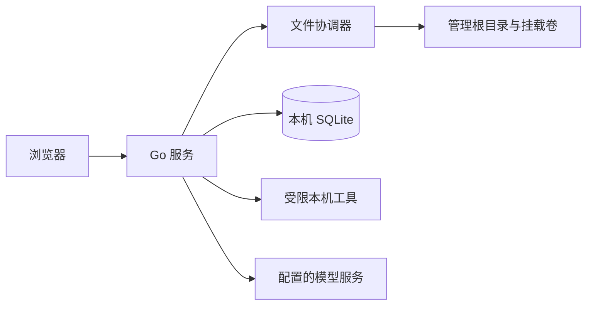

# 技术基线

**更新：** 2026-10-24

本文只保留当前架构和技术决策入口。方案比较和决策依据见各 ADR；当前发布状态见[项目状态](STATUS.md)，验收证据见[验收记录](ACCEPTANCE.md)。

## 架构

FileSage 是运行在 Linux 单机上的 Go 模块化单体，React 前端由同一服务提供。SQLite 保存可重建索引和任务元数据；原生文件系统是文件内容的唯一事实来源。

## 已采纳决策

| 范围 | 决策 | 记录 |
| --- | --- | --- |
| 服务端 | Go 模块化单体；工具按需启动为受限子进程 | [ADR-0001](design/adr/0001-go-modular-monolith.md) |
| 索引与任务 | 本机 SQLite WAL；文件索引可重建 | [ADR-0002](design/adr/0002-sqlite-metadata.md) |
| 文件操作 | 根目录约束、状态复核、协调提交；原件旧内容不留历史 | [ADR-0003](design/adr/0003-filesystem-write-safety.md) |
| 上传 | tus 断点续传至私有暂存，校验后发布 | [ADR-0004](design/adr/0004-resumable-upload.md) |
| 阅读器 | 按格式选用浏览器组件；Office 派生预览受限运行 | [ADR-0005](design/adr/0005-reader-rendering.md) |
| Shell | Bubblewrap 隔离副本、差异审阅、统一写回 | [ADR-0006](design/adr/0006-shell-staging-sandbox.md) |
| 前端 | React、TypeScript、Vite、Radix Primitives、Lucide | [ADR-0007](design/adr/0007-frontend-framework.md) |
| 文本编辑 | 私有暂存候选；数据库和日志不保存正文 | [ADR-0008](design/adr/0008-agent-text-edit-staging.md) |
| Agent | 持久会话、类型化工具步骤；整份计划审核后按模式执行 | [ADR-0009](design/adr/0009-agent-tool-steps.md) |

## 必须保持的边界

- 文件操作只接受管理根目录内的相对路径；写入统一复核文件状态并经过文件协调器。
- 模型建议不构成授权。用户审阅计划后才执行；Shell 先在隔离副本运行，不能建立隔离时拒绝执行。
- SQLite 和暂存数据放在管理根目录之外的本机服务数据目录；不以数据库代替文件内容。
- 服务无登录和 HTTPS，只部署在回环或可信局域网；可达服务的设备拥有管理文件的能力。
- 日志不记录密钥或文件正文。具体配置和运行方式见[部署说明](DEPLOYMENT.md)。

完整文档入口见[文档导航](README.md)。本页维护架构、技术边界和 ADR；发布状态与验收证据分别维护在[项目状态](STATUS.md)和[验收记录](ACCEPTANCE.md)。
